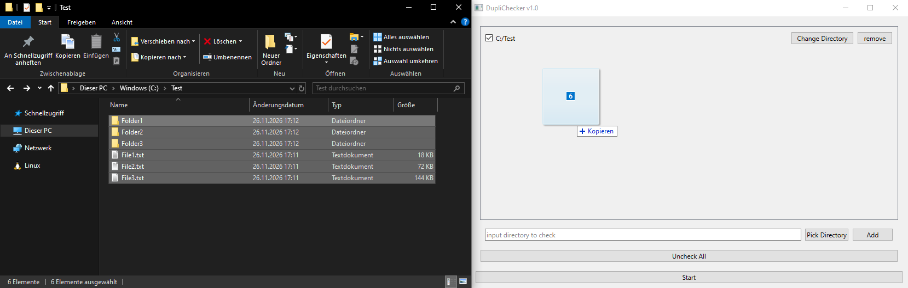
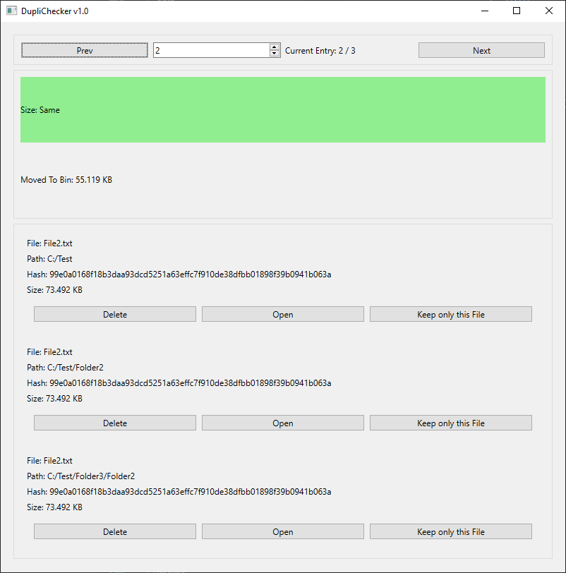

# Duplicate File Locater and Remover 
This desktop application calculates the SHA256 hash value of every file found in the specified target directories and compares them. If multiple files have the same hash, they will be displayed in a seperate view where every file can be opened, seperately deleted or the one file selected which won't be deleted. 

The used target directories, the found files and their hashes will be saved under "./data/" as simple json based text files.
Subsequent starts will both load the last used target directories and every previous hashed file.

Before new hashes are calculated, the previously loaded files are checked for their existence but not recalculated.
Content change won't be recognized and a name change will trigger deletion from the cache file.
This application is for data management for data hoarders and or messy users, both of which i'm a bit.

## Usage

First add at least one target directory, either via text input, the button 'Pick Directory' or Drag'n'Drop.
These targets can be toggle off/on or be deleted from this list. 
This comes in handy, if previously used target directories could be loaded.

The 'Start' button in the bottom starts the validation of the cached files from previous sessions and calculation of new found files. In case of slow hardware or high file count the current process is saved to file after every 10GBs processed .

This is the view where the found duplicates are displayed. Duplicates count if their hash is the same, but their size is ignored. There is button to open each file, delete this specific file or select the only file wich won't be deleted.
As a sanity check, the sizes are compared and the result is color coded (found files with the same hash, the same content(video) but different size).
Additionally counts the size of every deleted file in the current session.

## Prerequisites for running the code itself
programmed with Python 3.12 and the following packages:
- [Send2Trash](https://pypi.org/project/Send2Trash/)
- [PyQt6](https://pypi.org/project/PyQt6/)
